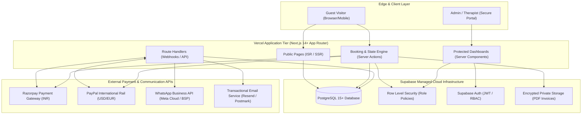
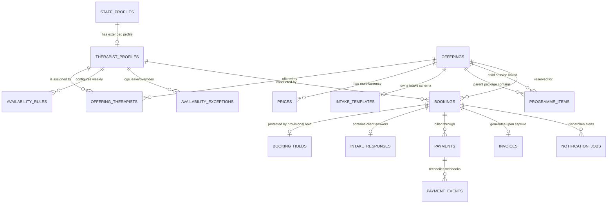
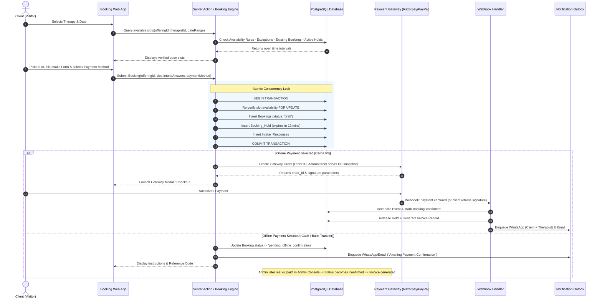
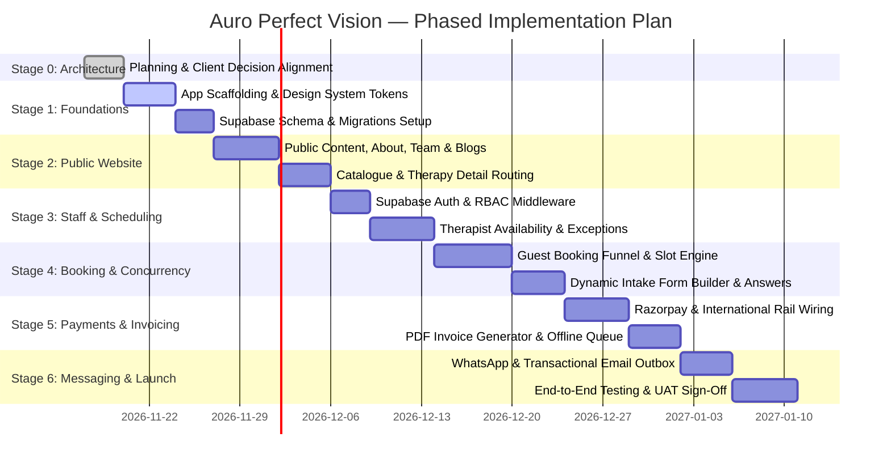

# AURO PERFECT VISION — TECHNICAL IMPLEMENTATION PLAN
**Target Brand:** Auro Perfect Vision (Affiliated with Auroville / Aurokiya Integral Eye Centre)  
**Document Version:** 1.0.0 (Planning Stage — Review Only)  
**Status:** Approved for Architecture Review; Implementation Execution Paused Pending Client Sign-Off  

---

## 1. Executive Summary & Architectural Scope

This document establishes the end-to-end technical architecture and staged implementation roadmap for the dedicated **Auro Perfect Vision** website and booking platform.

### Core Objectives
1. **Calm, High-Trust Public Experience:** An editorial, accessible, and responsive web portal presenting the organisation's vision, team, blogs, and holistic eye therapies rooted in the Auroville ethos.
2. **Frictionless Guest Booking Engine:** Seamless slot discovery, real-time availability calculation, dynamic per-session intake questionnaires, and zero-login guest booking.
3. **Resilient Dual-Currency Payment System:** Domestic INR payments via Razorpay (UPI, Netbanking, Cards) and International payment handling (PayPal or international cards), paired with manual offline payment workflows (Cash at centre, Bank transfer).
4. **Automated Document & Messaging Pipeline:** Post-capture PDF invoice generation, transactional email confirmations, and automated WhatsApp Business API notifications to clients and assigned therapists.
5. **Secure Role-Based Portals:** Independent portals for Therapists (availability, exception calendars, assigned appointments) and Admins (catalogue management, intake form builder, bookings ledger, payment reconciliation, CMS content management).

---

## 2. Website Sitemap & Page Architecture

The platform combines public static/ISR marketing pages, a transactional multi-step guest booking funnel, and authenticated role-gated administration dashboards.

```
Public Web Experience (Zero-Auth)
├── / (Home: Mission, Featured Therapies, Flagship Programmes, Auroville Legacy, Booking CTA)
├── /about (Organisation Background, Holistic Eye Care Methodology, Auroville Connection)
├── /therapies (Dynamic Catalogue: Search, Filter by Format [1:1 / Group] & Delivery [Online / On-site])
│   └── /therapies/[slug] (Detailed Syllabus, Duration, Pricing, Assigned Therapists, Direct Booking CTA)
├── /team (Therapist & Staff Profiles: Bios, Eye Care Specialties, Qualifications)
├── /blogs (Articles, Eye Health Tips, Organisation News)
│   └── /blogs/[slug] (Article Detail with Schema.org MedicalWebPage / BlogPosting metadata)
├── /book/[offeringSlug] (Multi-step Booking Flow: Therapist -> Slot -> Dynamic Intake -> Payment)
└── /booking/[reference] (Secure Confirmation, Status Tracking, PDF Invoice Retrieval via Token)

Staff & Therapist Portal (Authenticated via Supabase Auth)
├── /login (Staff & Therapist Email/Password Login + Magic Link option)
├── /therapist (Therapist Workspace)
│   ├── /therapist/schedule (Weekly Recurring Availability Matrix & One-off Exception Leave)
│   ├── /therapist/bookings (Calendar/List view of assigned appointments & sanitized intake summaries)
│   └── /therapist/profile (Public bio preview & contact settings)
└── /admin (Admin Management Console)
    ├── /admin/dashboard (Operational KPIs: Today's sessions, pending offline approvals, revenue)
    ├── /admin/offerings (CRUD for Sessions & Flagship Programmes, multi-tier pricing, duration)
    ├── /admin/intake-forms (Drag-and-drop form builder: custom fields, validation rules per offering)
    ├── /admin/bookings (Global booking ledger: search, filter, manual reschedule, cancellation)
    ├── /admin/payments (Offline payment confirmation queue, transaction audit, invoice reissue)
    ├── /admin/therapists (Staff onboarding, session eligibility mapping, capacity overrides)
    └── /admin/cms (Editor for Blogs, Team Profiles, and Site Announcements)
```

### Route-Level Rendering Strategy
- **Static Site Generation (SSG) with On-Demand Revalidation (ISR):** `/`, `/about`, `/team`, `/blogs`, `/blogs/[slug]`, `/therapies`. Content updates made in `/admin/cms` trigger targeted revalidation tags (`revalidateTag('offerings')`, `revalidateTag('cms')`).
- **Dynamic Server-Side Rendering (SSR) with Edge Guards:** `/book/[offeringSlug]` and `/booking/[reference]` to enforce live database slot holds, real-time pricing verification, and tokenized authorization.
- **Client-Side SPA Shell with Server Actions:** All `/admin/*` and `/therapist/*` routes wrapped in authenticated Next.js route groups `(dashboard)` leveraging React Server Components for initial data hydration and authenticated Server Actions for mutations.

---

## 3. Technology Stack & Infrastructure Architecture



---

## 4. PostgreSQL Database Schema & Entity Relationships

The schema is built with strict relational integrity, UUID primary keys, UTC timestamp normalization, and PostgreSQL Row-Level Security (RLS).

### Entity Relationship Diagram (ERD)



### Table Definitions & Schema Specification

```sql
-- Enums
CREATE TYPE staff_role AS ENUM ('admin', 'therapist');
CREATE TYPE offering_format AS ENUM ('individual', 'group');
CREATE TYPE offering_delivery AS ENUM ('online', 'onsite');
CREATE TYPE booking_status AS ENUM (
  'draft',
  'awaiting_online_payment',
  'pending_offline_confirmation',
  'confirmed',
  'cancelled',
  'completed',
  'no_show',
  'needs_review'
);
CREATE TYPE payment_status AS ENUM (
  'not_started',
  'initiated',
  'pending',
  'captured',
  'failed',
  'offline_confirmed',
  'refunded'
);
CREATE TYPE payment_gateway AS ENUM ('razorpay', 'paypal', 'offline_cash', 'offline_bank_transfer');
CREATE TYPE invoice_status AS ENUM ('not_issued', 'issued', 'voided');

-- 1. Staff Profiles (Auth extension)
CREATE TABLE staff_profiles (
  id UUID PRIMARY KEY REFERENCES auth.users(id) ON DELETE CASCADE,
  role staff_role NOT NULL,
  email TEXT UNIQUE NOT NULL,
  full_name TEXT NOT NULL,
  phone TEXT,
  is_active BOOLEAN DEFAULT TRUE NOT NULL,
  created_at TIMESTAMPTZ DEFAULT TIMEZONE('utc', NOW()) NOT NULL,
  updated_at TIMESTAMPTZ DEFAULT TIMEZONE('utc', NOW()) NOT NULL
);

-- 2. Therapist Profiles (Publicly visible metadata)
CREATE TABLE therapist_profiles (
  id UUID PRIMARY KEY DEFAULT gen_random_uuid(),
  staff_id UUID UNIQUE REFERENCES staff_profiles(id) ON DELETE CASCADE,
  slug TEXT UNIQUE NOT NULL,
  display_name TEXT NOT NULL,
  bio TEXT NOT NULL,
  specialties TEXT[] DEFAULT '{}' NOT NULL,
  photo_url TEXT,
  display_order INT DEFAULT 0 NOT NULL,
  is_published BOOLEAN DEFAULT TRUE NOT NULL,
  created_at TIMESTAMPTZ DEFAULT TIMEZONE('utc', NOW()) NOT NULL
);

-- 3. Offerings (Sessions & Flagship Programmes)
CREATE TABLE offerings (
  id UUID PRIMARY KEY DEFAULT gen_random_uuid(),
  slug TEXT UNIQUE NOT NULL,
  title TEXT NOT NULL,
  short_description TEXT NOT NULL,
  full_description TEXT NOT NULL,
  duration_minutes INT NOT NULL, -- e.g. 60
  format offering_format NOT NULL, -- individual / group
  delivery offering_delivery NOT NULL, -- online / onsite
  max_capacity INT DEFAULT 1 NOT NULL, -- 1 for individual, >1 for group retreats/workshops
  is_flagship_programme BOOLEAN DEFAULT FALSE NOT NULL,
  is_published BOOLEAN DEFAULT TRUE NOT NULL,
  created_at TIMESTAMPTZ DEFAULT TIMEZONE('utc', NOW()) NOT NULL,
  updated_at TIMESTAMPTZ DEFAULT TIMEZONE('utc', NOW()) NOT NULL
);

-- 4. Offering-Therapist Assignment (Many-to-Many)
CREATE TABLE offering_therapists (
  offering_id UUID REFERENCES offerings(id) ON DELETE CASCADE,
  therapist_id UUID REFERENCES therapist_profiles(id) ON DELETE CASCADE,
  PRIMARY KEY (offering_id, therapist_id)
);

-- 5. Multi-Currency Pricing
CREATE TABLE prices (
  id UUID PRIMARY KEY DEFAULT gen_random_uuid(),
  offering_id UUID REFERENCES offerings(id) ON DELETE CASCADE NOT NULL,
  currency VARCHAR(3) NOT NULL, -- 'INR', 'USD', 'EUR'
  amount_cents INT NOT NULL, -- Stored as integer (e.g. 250000 = ₹2500.00)
  tax_inclusive BOOLEAN DEFAULT TRUE NOT NULL,
  is_active BOOLEAN DEFAULT TRUE NOT NULL,
  created_at TIMESTAMPTZ DEFAULT TIMEZONE('utc', NOW()) NOT NULL,
  CONSTRAINT unique_active_offering_currency UNIQUE (offering_id, currency, is_active)
);

-- 6. Programme Items (For Multi-session Packages & Fixed Schedules)
CREATE TABLE programme_items (
  id UUID PRIMARY KEY DEFAULT gen_random_uuid(),
  programme_id UUID REFERENCES offerings(id) ON DELETE CASCADE NOT NULL,
  session_id UUID REFERENCES offerings(id) ON DELETE RESTRICT,
  sequence_order INT NOT NULL,
  custom_title TEXT,
  fixed_start_time TIMESTAMPTZ, -- Populated if programme runs on fixed calendar dates
  created_at TIMESTAMPTZ DEFAULT TIMEZONE('utc', NOW()) NOT NULL
);

-- 7. Therapist Recurring Availability Rules
CREATE TABLE availability_rules (
  id UUID PRIMARY KEY DEFAULT gen_random_uuid(),
  therapist_id UUID REFERENCES therapist_profiles(id) ON DELETE CASCADE NOT NULL,
  day_of_week INT NOT NULL CHECK (day_of_week BETWEEN 0 AND 6), -- 0=Sun, 1=Mon, ..., 6=Sat
  start_time TIME NOT NULL, -- e.g. '09:00:00'
  end_time TIME NOT NULL, -- e.g. '13:00:00'
  slot_duration_minutes INT DEFAULT 60 NOT NULL,
  buffer_minutes INT DEFAULT 15 NOT NULL,
  is_active BOOLEAN DEFAULT TRUE NOT NULL,
  CONSTRAINT valid_time_range CHECK (end_time > start_time)
);

-- 8. Therapist Availability Exceptions (Leave & Overrides)
CREATE TABLE availability_exceptions (
  id UUID PRIMARY KEY DEFAULT gen_random_uuid(),
  therapist_id UUID REFERENCES therapist_profiles(id) ON DELETE CASCADE NOT NULL,
  exception_date DATE NOT NULL,
  is_unavailable BOOLEAN DEFAULT TRUE NOT NULL, -- true = full day off
  override_start_time TIME, -- populated if providing custom hours on this date
  override_end_time TIME,
  reason TEXT,
  created_at TIMESTAMPTZ DEFAULT TIMEZONE('utc', NOW()) NOT NULL
);

-- 9. Intake Form Templates (Versioned per Offering)
CREATE TABLE intake_templates (
  id UUID PRIMARY KEY DEFAULT gen_random_uuid(),
  offering_id UUID REFERENCES offerings(id) ON DELETE CASCADE NOT NULL,
  version INT DEFAULT 1 NOT NULL,
  is_active BOOLEAN DEFAULT TRUE NOT NULL,
  created_at TIMESTAMPTZ DEFAULT TIMEZONE('utc', NOW()) NOT NULL,
  CONSTRAINT unique_active_offering_template UNIQUE (offering_id, version)
);

-- 10. Intake Form Fields
CREATE TABLE intake_fields (
  id UUID PRIMARY KEY DEFAULT gen_random_uuid(),
  template_id UUID REFERENCES intake_templates(id) ON DELETE CASCADE NOT NULL,
  field_key TEXT NOT NULL, -- e.g. 'eye_condition_description'
  label TEXT NOT NULL,
  field_type TEXT NOT NULL, -- 'text', 'textarea', 'select', 'radio', 'checkbox', 'number'
  placeholder TEXT,
  help_text TEXT,
  options JSONB, -- For select/radio: ['Myopia', 'Dry Eyes', 'Other']
  is_required BOOLEAN DEFAULT FALSE NOT NULL,
  display_order INT DEFAULT 0 NOT NULL
);

-- 11. Bookings (Core Transaction Entity)
CREATE TABLE bookings (
  id UUID PRIMARY KEY DEFAULT gen_random_uuid(),
  booking_reference VARCHAR(16) UNIQUE NOT NULL, -- e.g. 'APV-2026-X8Y2K'
  access_token_hash TEXT NOT NULL, -- SHA-256 hash of secret link token
  offering_id UUID REFERENCES offerings(id) ON DELETE RESTRICT NOT NULL,
  therapist_id UUID REFERENCES therapist_profiles(id) ON DELETE RESTRICT NOT NULL,
  start_time TIMESTAMPTZ NOT NULL,
  end_time TIMESTAMPTZ NOT NULL,
  status booking_status DEFAULT 'draft' NOT NULL,
  
  -- Guest Client Contact
  guest_name TEXT NOT NULL,
  guest_email TEXT NOT NULL,
  guest_phone TEXT NOT NULL, -- International format (+91...)
  client_timezone TEXT DEFAULT 'Asia/Kolkata' NOT NULL,
  
  -- Immutable Snapshots
  currency VARCHAR(3) NOT NULL,
  total_amount_cents INT NOT NULL,
  offering_snapshot JSONB NOT NULL, -- Title, duration, mode, etc. at time of booking
  
  created_at TIMESTAMPTZ DEFAULT TIMEZONE('utc', NOW()) NOT NULL,
  updated_at TIMESTAMPTZ DEFAULT TIMEZONE('utc', NOW()) NOT NULL
);

-- 12. Booking Holds (Atomic Concurrency Reservation)
CREATE TABLE booking_holds (
  id UUID PRIMARY KEY DEFAULT gen_random_uuid(),
  booking_id UUID UNIQUE REFERENCES bookings(id) ON DELETE CASCADE NOT NULL,
  therapist_id UUID REFERENCES therapist_profiles(id) ON DELETE CASCADE NOT NULL,
  slot_start TIMESTAMPTZ NOT NULL,
  slot_end TIMESTAMPTZ NOT NULL,
  expires_at TIMESTAMPTZ NOT NULL, -- e.g. NOW() + INTERVAL '12 minutes'
  is_released BOOLEAN DEFAULT FALSE NOT NULL
);

-- 13. Intake Responses (Client Medical / History Answers)
CREATE TABLE intake_responses (
  id UUID PRIMARY KEY DEFAULT gen_random_uuid(),
  booking_id UUID UNIQUE REFERENCES bookings(id) ON DELETE CASCADE NOT NULL,
  template_version INT NOT NULL,
  answers JSONB NOT NULL, -- Key-value pairs matching intake_fields
  submitted_at TIMESTAMPTZ DEFAULT TIMEZONE('utc', NOW()) NOT NULL
);

-- 14. Payments
CREATE TABLE payments (
  id UUID PRIMARY KEY DEFAULT gen_random_uuid(),
  booking_id UUID REFERENCES bookings(id) ON DELETE RESTRICT NOT NULL,
  gateway payment_gateway NOT NULL,
  gateway_order_id TEXT, -- Razorpay order_id / PayPal order ID
  gateway_payment_id TEXT, -- Razorpay payment_id / PayPal capture ID
  currency VARCHAR(3) NOT NULL,
  amount_cents INT NOT NULL,
  status payment_status DEFAULT 'not_started' NOT NULL,
  confirmed_by_staff_id UUID REFERENCES staff_profiles(id), -- For offline payments
  confirmed_at TIMESTAMPTZ,
  created_at TIMESTAMPTZ DEFAULT TIMEZONE('utc', NOW()) NOT NULL,
  updated_at TIMESTAMPTZ DEFAULT TIMEZONE('utc', NOW()) NOT NULL
);

-- 15. Payment Webhook Events (Idempotency Ledger)
CREATE TABLE payment_events (
  id UUID PRIMARY KEY DEFAULT gen_random_uuid(),
  gateway payment_gateway NOT NULL,
  event_id TEXT NOT NULL, -- e.g. Razorpay event.id
  event_type TEXT NOT NULL,
  payload JSONB NOT NULL,
  is_processed BOOLEAN DEFAULT FALSE NOT NULL,
  processed_at TIMESTAMPTZ,
  created_at TIMESTAMPTZ DEFAULT TIMEZONE('utc', NOW()) NOT NULL,
  CONSTRAINT unique_gateway_event UNIQUE (gateway, event_id)
);

-- 16. Invoices (Sequential Immutable Billing Document)
CREATE TABLE invoices (
  id UUID PRIMARY KEY DEFAULT gen_random_uuid(),
  invoice_number VARCHAR(32) UNIQUE NOT NULL, -- e.g. 'APV-2026-0001'
  booking_id UUID UNIQUE REFERENCES bookings(id) ON DELETE RESTRICT NOT NULL,
  payment_id UUID UNIQUE REFERENCES payments(id) ON DELETE RESTRICT NOT NULL,
  status invoice_status DEFAULT 'issued' NOT NULL,
  pdf_storage_path TEXT NOT NULL, -- Supabase Storage private path
  billing_details_snapshot JSONB NOT NULL, -- Name, address, GSTIN, line items
  issued_at TIMESTAMPTZ DEFAULT TIMEZONE('utc', NOW()) NOT NULL
);

-- 17. Notification Jobs (Reliable Outbox Queue)
CREATE TABLE notification_jobs (
  id UUID PRIMARY KEY DEFAULT gen_random_uuid(),
  booking_id UUID REFERENCES bookings(id) ON DELETE CASCADE NOT NULL,
  channel TEXT NOT NULL CHECK (channel IN ('whatsapp', 'email')),
  recipient TEXT NOT NULL,
  template_name TEXT NOT NULL,
  payload JSONB NOT NULL,
  status TEXT DEFAULT 'pending' CHECK (status IN ('pending', 'sent', 'failed')),
  attempts INT DEFAULT 0 NOT NULL,
  last_error TEXT,
  scheduled_for TIMESTAMPTZ DEFAULT TIMEZONE('utc', NOW()) NOT NULL,
  sent_at TIMESTAMPTZ,
  created_at TIMESTAMPTZ DEFAULT TIMEZONE('utc', NOW()) NOT NULL
);

-- 18. CMS Content: Blog Posts
CREATE TABLE blog_posts (
  id UUID PRIMARY KEY DEFAULT gen_random_uuid(),
  slug TEXT UNIQUE NOT NULL,
  title TEXT NOT NULL,
  excerpt TEXT NOT NULL,
  content_markdown TEXT NOT NULL,
  cover_image_url TEXT,
  author_staff_id UUID REFERENCES staff_profiles(id) ON DELETE SET NULL,
  is_published BOOLEAN DEFAULT FALSE NOT NULL,
  published_at TIMESTAMPTZ,
  created_at TIMESTAMPTZ DEFAULT TIMEZONE('utc', NOW()) NOT NULL,
  updated_at TIMESTAMPTZ DEFAULT TIMEZONE('utc', NOW()) NOT NULL
);

-- 19. Audit Log (Privileged Staff Actions)
CREATE TABLE audit_logs (
  id UUID PRIMARY KEY DEFAULT gen_random_uuid(),
  actor_staff_id UUID REFERENCES staff_profiles(id) ON DELETE SET NULL,
  action TEXT NOT NULL, -- 'OFFLINE_PAYMENT_CONFIRMED', 'PRICE_UPDATED', etc.
  target_entity TEXT NOT NULL, -- 'bookings', 'payments', etc.
  target_id UUID NOT NULL,
  details JSONB,
  ip_address TEXT,
  created_at TIMESTAMPTZ DEFAULT TIMEZONE('utc', NOW()) NOT NULL
);
```

---

## 5. Guest Booking Flow, Availability Engine & State Transitions

### End-to-End Booking Lifecycle



### Slot Availability Invariant Rules
To guarantee zero double-booking in a concurrent environment:
1. **Rule Calculation:**
   $$\text{Available Slots} = \text{Recurring Rules} \setminus (\text{Exceptions} \cup \text{Confirmed Bookings} \cup \text{Active Unexpired Holds})$$
2. **Atomic Verification:** Slot generation is advisory; slot reservation is strict. When checkout is initiated, a database transaction checks for conflicting overlapping rows (`TSTZRANGE(start_time, end_time) && [requested_slot]`) using PostgreSQL exclusion constraints or `SELECT ... FOR UPDATE`.
3. **Provisional Hold Expiry:** Online holds have an automatic TTL (12 minutes). If a webhook or client return does not confirm payment before TTL expires, a scheduled worker marks the hold as released, freeing the slot for other guests.
4. **Group Capacity Handling:** For offerings with `format = 'group'`, slots remain open until:
   $$\sum \text{Confirmed Attendees} + \sum \text{Active Holds} \ge \text{max\_capacity}$$

---

## 6. Payment, Invoicing, Email & WhatsApp Integrations

### 1. Dual Payment Strategy
- **Domestic India Rail (Razorpay):**
  - Handles UPI, Netbanking, Rupay/Visa/Mastercard domestic cards.
  - Integration: Razorpay Standard Checkout via Server-side Orders API (`/v1/orders`).
  - Strict HMAC SHA256 signature verification on both client return handler and incoming webhooks (`order.paid`, `payment.captured`).
- **International Rail (PayPal / Razorpay International):**
  - Handles USD/EUR payments for non-Indian clients.
  - Captures international billing address requirements; enforces zero currency conversion ambiguity by charging in configured offering currency.
- **Offline Payment Handling:**
  - Guests receive a bank transfer wire instruction modal or cash-at-centre receipt voucher with unique reference (`APV-YYYY-XXXXX`).
  - Booking is logged as `pending_offline_confirmation`.
  - Admin verifies bank credit or physical cash collection, triggering the authenticated transition to `confirmed`.

### 2. PDF Invoicing Pipeline
- **Generator Engine:** `@react-pdf/renderer` executing within an isolated server-side Node.js environment.
- **Immutable Snapshot:** Once created, invoice details are locked; dynamic price changes in the catalogue never alter historic invoices.
- **Storage & Retrieval:** Rendered PDF stored in private Supabase Storage bucket (`invoices/{booking_reference}.pdf`).
- **Secure Access Token:** Re-download link on `/booking/[reference]?token=SECRET` validates against `access_token_hash` in the database. Raw booking IDs or sequential invoice numbers never grant public download permissions.

### 3. Messaging & Communications Architecture
- **WhatsApp Business API:**
  - Sent via official Meta Cloud API or certified Business Solution Provider (BSP).
  - Templates pre-approved for transactional utility messages:
    - `booking_confirmed_client`: Date, time (localized), therapy name, therapist name, venue / meeting URL link, invoice download link.
    - `booking_confirmed_therapist`: New appointment notification with client name, time, and session mode.
    - `booking_pending_offline`: Reminder of payment instructions and held reservation time.
    - `booking_reminder_24h` (Optional): 24-hour pre-session alert.
- **Transactional Email:**
  - Dispatched via Resend / Postmark with SPF, DKIM, and DMARC verified on `auroperfectvision.com` (or confirmed client domain).
  - Clean HTML layout with embedded PDF invoice attachment and calendar invite (`.ics` file).

---

## 7. Role Permission Matrix & Dashboard Capabilities

| Capability / Module | Guest (Visitor) | Assigned Therapist | Admin (Aurokiya Staff) |
|---|:---:|:---:|:---:|
| Browse Public Catalogue & Read Blogs | Read | Read | Read |
| Book Slot & Fill Intake Form | Create (Own) | No | Create (On behalf) |
| View Assigned Bookings | Tokenized (Own) | Read (Assigned only) | Full Read (All) |
| Manage Weekly Recurring Availability | No | Read / Write (Own) | Read / Write (All) |
| Log One-Off Leave & Date Exceptions | No | Read / Write (Own) | Read / Write (All) |
| Access Full Medical Intake Answers | No | Read (Assigned only) | Full Read / Export |
| Edit Offerings, Durations & Pricing | No | No | Full Read / Write |
| Build / Reorder Dynamic Intake Fields | No | No | Full Read / Write |
| Mark Offline Bookings as Paid | No | No | Full Authorize |
| Void / Reissue PDF Invoices | No | No | Full Authorize |
| Manage Staff & Therapist Accounts | No | No | Full Admin |
| Edit Static CMS Content (Blogs, Team) | No | No | Full Read / Write |
| View Financial Audit Logs | No | No | Full Read |

---

## 8. Security, Privacy & Data Protection Safeguards

1. **Zero-Trust Access Token Model for Guests:**
   Guests do not have accounts. To prevent enumeration attacks on sequential or short references, each booking generates a cryptographically secure 256-bit random access token. Only the SHA-256 hash is stored in the database. The client holds the cleartext token in their confirmation URL.
2. **Row Level Security (RLS):**
   Postgres tables enforce strict RLS policies. Even if a therapist makes a direct API call, database policies restrict `SELECT` on `bookings` and `intake_responses` strictly to rows matching `therapist_id = auth.uid()`.
3. **Medical & Intake Privacy Compliance:**
   Intake responses (eye conditions, medical histories) are classified as sensitive personal data. They are never transmitted over unencrypted channels, never included in WhatsApp message bodies, and excluded from general staff activity logs.
4. **Payment Idempotency & Replay Protection:**
   All webhook receivers log incoming payloads into `payment_events`. If a webhook with duplicate `event_id` arrives, it returns `200 OK` immediately without re-triggering invoices, state changes, or customer notifications.

---

## 9. Phased Implementation Roadmap



### Stage Summary Breakdown
- **Stage 0: Architecture & Client Alignment (Current):** Review deliverables with project owner, freeze database ERD, resolve critical gateway and branding choices.
- **Stage 1: Technical Foundations:** Next.js 14 App Router, Tailwind configuration with brand tokens, Supabase database migrations, Row Level Security baseline.
- **Stage 2: Public Front-End & CMS:** Editorial pages, therapy catalogue, responsive layouts, SEO tags, dynamic blog reader.
- **Stage 3: Authentication & Therapist Scheduling:** Therapist portal, weekly recurring availability grid, leave blocker calendar, real-time slot calculator service.
- **Stage 4: Guest Booking Engine & Intake Forms:** Multi-step wizard, atomic reservation hold transactions, admin drag-and-drop intake field builder.
- **Stage 5: Payments & Automated Invoicing:** Razorpay and PayPal server integrations, webhook idempotency, PDF invoice generation, admin offline confirmation workflow.
- **Stage 6: Messaging, Security Audit & Launch:** WhatsApp Cloud API integration, email pipeline, comprehensive concurrency and security verification, production deployment.

---

## 10. Quality Assurance & Acceptance Test Plan

1. **Concurrency Stress Testing:** Simulate 10 simultaneous guest requests booking the exact same therapist time-slot. Verify that exactly 1 booking succeeds in reserving the slot hold and 9 receive a clean "Slot no longer available" warning.
2. **Hold Expiry Verification:** Create an online checkout hold, allow the 12-minute TTL to elapse without payment, and verify that the slot automatically reappears in the public availability feed.
3. **Webhook Replay & Tamper Test:** Replay identical captured Razorpay webhooks 5 times. Verify that only a single invoice and single confirmation message are generated. Submit a webhook with an invalid HMAC signature and verify an immediate 401 rejection.
4. **Role Isolation Audit:** Attempt to access admin endpoints and therapist bookings using a guest session (must yield 401/403). Attempt to access Therapist B's intake responses while authenticated as Therapist A (must yield 403 / zero rows).
5. **Mobile Responsiveness & Accessibility:** Full WCAG 2.2 AA audit covering touch targets (min 44px), contrast ratios across brand colors, screen reader navigation on calendar date pickers, and zero horizontal scrolling on mobile viewports.
