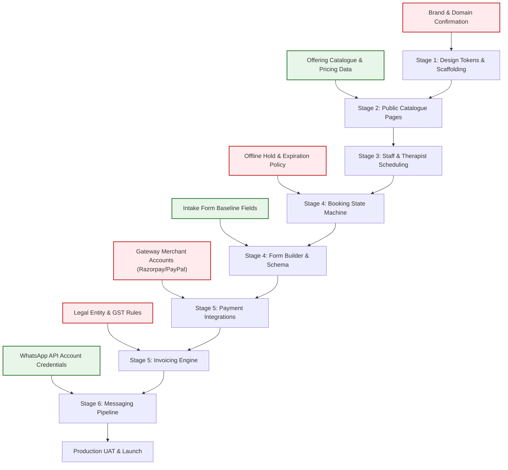

# AURO PERFECT VISION — OPEN CLIENT DECISIONS & DEPENDENCY MATRIX
**Target Brand:** Auro Perfect Vision (Affiliated with Auroville / Aurokiya Integral Eye Centre)  
**Document Version:** 1.0.0 (Planning Stage)  
**Status:** Action Items for Client Review Prior to Implementation Stages  

---

## 1. Overview & Prioritization Framework

To prevent costly architectural rework, this document compiles all unresolved business rules, entity choices, legal configurations, and technical dependencies identified across `Aurokiya_Requirements_Document.pdf` and `Auro_Perfect_Vision_Antigravity_Master_Blueprint.md`.

Decisions are categorized into two tiers:
- **Tier 1: Blocking Decisions (Stage 0–3 Dependency):** Decisions that directly define database schemas, payment merchant accounts, tax engines, or core booking state machines. *Work on respective backend stages cannot start without these answers.*
- **Tier 2: Non-Blocking / Content Decisions (Stage 4–6 Dependency):** Decisions related to front-end copywriting, design assets, notification copy, or non-critical operational policies. *These can be refined while initial foundational architecture is assembled.*

---

## 2. Document Conflicts & Naming Ambiguities

| Topic | Source Requirements PDF | Antigravity Master Blueprint | Impact & Resolution Required |
|---|---|---|---|
| **Brand & Website Name** | Titled *"Aurokiya Integral Eye Centre"* across all pages. | Explicit instruction from project owner: Website title, logo, metadata, and public brand must be **Auro Perfect Vision**. | **Resolution:** Confirm whether the legal/billing entity remains "Aurokiya Integral Eye Centre" while the public-facing brand is "Auro Perfect Vision", or if a formal renaming applies to all levels. |
| **Domain & Hosting** | Not specified. Mentions "dedicated system for Aurokiya only". | Mentions `auroperfectvision.com` as prospective domain. | **Resolution:** Confirm official domain name purchase and DNS control ownership. |
| **International Gateway** | Recommends PayPal as lightweight rail; Razorpay international add-on as fallback. | Points out Indian regulatory constraints for PayPal merchant onboarding for Indian entities. | **Resolution:** Confirm client's existing business registrations and merchant accounts for PayPal India or international Razorpay activation. |
| **Offline Booking Holds** | States offline bookings remain "pending payment confirmation" until staff marks as paid. | Identifies that without an expiry rule, unpaid offline bookings could block calendar slots indefinitely. | **Resolution:** Determine whether offline reservations hold the slot until manual admin action or expire after a fixed window (e.g., 48 hours). |

---

## 3. Tier 1: Blocking Decisions (Required for Schema & Backend)

### 3.1. Legal Entity, Tax & Invoicing Configuration
*Blocks Stage 1 (Database Schema) & Stage 5 (Invoicing Engine)*
1. **Registered Legal Entity Details:**
   - What exact legal entity name and address should appear on generated tax invoices?
   - *Options:* (A) Aurokiya Integral Eye Centre, Auroville; (B) Auro Perfect Vision; (C) A registered trust/foundation under Auroville Foundation.
2. **GST Registration Status:**
   - Is the organisation GST-registered in India?
   - If yes, what is the GSTIN, and what SAC/HSN code and GST rate apply to health/eye-care therapies (e.g. 18% vs Nil/Exempt for health services)?
   - If exempt, what statutory declaration text must be printed on invoices?
3. **Invoice Numbering Scheme:**
   - What sequential convention should be adopted?
   - *Default Proposal:* `APV-YYYY-XXXX` (e.g. `APV-2026-0001`), resetting annually or by financial year (`APV-2627-0001`).

### 3.2. Payment Rails & Merchant Onboarding
*Blocks Stage 5 (Payment Integrations)*
1. **Domestic Gateway Selection:**
   - Confirm if **Razorpay** is the chosen provider.
   - Does an active, KYC-verified Razorpay merchant account already exist for this entity?
2. **International Payments Strategy:**
   - Will international clients pay via **PayPal** (requires PayPal Business Account linked to Indian bank with purpose code) or **Razorpay International** (requires export IEC/FIRC enablement)?
   - Which currencies will be accepted? Default: INR (domestic), USD and EUR (international).
3. **Offline Payment Methods:**
   - Which specific offline methods are supported?
     - [ ] Cash payment at the Centre (on appointment day)
     - [ ] Direct NEFT/RTGS/IMPS Bank Transfer (requires manual proof upload or reference check)
     - [ ] UPI QR code at the desk

### 3.3. Booking Capacity & Reservation Rules
*Blocks Stage 3 (Availability Engine) & Stage 4 (Booking Engine)*
1. **Offline Hold Policy & Expiration:**
   - When a client books with "Pay at Centre", how long is the slot reserved?
     - *Option A:* Reserved indefinitely until staff marks paid or cancels.
     - *Option B (Recommended):* Reserved conditionally until 24 hours prior to session; auto-cancelled if unconfirmed.
     - *Option C:* Immediate confirmation with payment collected upon arrival.
2. **Scheduling Granularity & Buffers:**
   - What buffer time is required between consecutive sessions for therapists (e.g., 15 minutes for sanitization/notes)?
   - What is the minimum booking advance notice required (e.g., minimum 12 hours before slot time)?
   - What is the maximum advance booking window (e.g., bookings open 30 days in advance)?
3. **Cancellations & Rescheduling Policy:**
   - Are clients allowed to self-reschedule using their confirmation link?
   - If a client cancels, what is the refund policy? (Requirements document states refund automation is currently out of scope, but policy wording must be displayed).

---

## 4. Tier 2: Non-Blocking / Content Decisions (Required for Front-End & Operations)

### 4.1. Offering Catalogue & Initial Data
*Required for Stage 2 (Public Catalogue & CMS Seeding)*
1. **Initial List of Therapies & Flagship Programmes:**
   - Complete names, descriptions, session durations (e.g. 45 min, 60 min, 90 min).
   - Mode classification for each offering:
     - Delivery: `Online`, `On-site (Auroville)`, or `Hybrid/Both`
     - Format: `Individual (1:1)` or `Group (Workshop/Retreat)`
   - Dual-currency pricing table (e.g. ₹2,500 INR / $45 USD).
   - Maximum capacity limits for group programmes.
2. **Online Meeting Infrastructure:**
   - For `Online` sessions, how are meeting links provisioned?
     - *Option A:* Static Google Meet / Zoom link per therapist stored in their profile.
     - *Option B:* Admin manually inserts meeting link into booking record prior to session.
     - *Option C (Future scope):* Automated Zoom/Google Calendar API link generation.

### 4.2. Intake Form Specifications
*Required for Stage 4 (Dynamic Form Builder)*
1. **Baseline Standard Fields:**
   - Confirm standard fields across all sessions:
     - Full Name (Client)
     - Age / Date of Birth
     - Contact Phone (WhatsApp enabled)
     - Email Address
     - City / Country of Residence
     - Primary Eye Condition / Symptoms
     - Prior Consultation / Medical History
     - How did you hear about Auro Perfect Vision?
2. **Sensitive Health Data Handling:**
   - Confirm whether file attachments (e.g., past optical prescriptions, ophthalmologist reports) are permitted in this phase or deferred.

### 4.3. Communications & WhatsApp Integration
*Required for Stage 6 (Messaging Integration)*
1. **WhatsApp Business Account (WABA):**
   - Does Auro Perfect Vision have a verified Meta Business Manager account with a dedicated phone number for WhatsApp API?
   - If not, who will be the Business Solution Provider (BSP) (e.g. Meta Cloud API, Gupshup, Wati)?
2. **Notification Templates & Reminders:**
   - Agree on exact template copy for client confirmation and therapist notification.
   - Confirm if an automated 24-hour pre-session reminder is desired.

### 4.4. Brand Assets & Media Permissions
*Required for Stage 1–2 (Design & Visual Identity)*
1. **Official Brand Assets:**
   - High-resolution SVG/PNG logo files for **Auro Perfect Vision**.
   - Official brand guidelines (if existing), primary color codes, and authorized typography.
2. **Photography & Imagery:**
   - High-resolution photographs of the Auroville centre, therapy rooms, equipment, and staff/therapists.
   - Clarification on copyright/reuse permissions for any materials currently appearing on legacy sites or social channels.

### 4.5. Frontend Prototype Discoveries & Policy Clarifications
*Identified during frontend implementation & verification*
1. **Official Tariff & Pricing Approval:**
   - The frontend currently models verified service names with realistic sample rates (e.g. Eye Yoga at ₹2,000 INR / $40 USD; 7-Day Retreat at ₹18,000 INR / $350 USD). The client must supply official approved rates before production payment rails are enabled.
2. **Staff Roster Verification:**
   - Confirm verified practitioner names, high-resolution portraits, bios, and qualifications to replace the demo profiles (`Dr. Ananya Sen` and `Rajesh Kannan`).
3. **Automated Offline Hold Window:**
   - Proposed default: offline reservations hold a slot until 24 hours before session time; if unconfirmed by staff, the slot automatically releases to the public pool. Client confirmation required.
4. **Online Consultation Platform:**
   - For remote sessions, confirm preferred video link automation (Google Meet link generated per therapist vs Zoom API integration).

---

## 5. Dependency Graph & Critical Path

---

## 6. Next Steps for Project Stakeholders

1. **Review Tier 1 Decisions:** Schedule a dedicated alignment session with the client team to resolve Legal Entity, GST status, Gateway selection, and Offline Hold policies.
2. **Asset Handover:** Secure official logo vectors and high-resolution photography.
3. **Formal Approval:** Provide sign-off on the core architecture to authorize the commencement of Stage 1 (Technical Foundations & Schema Migration).
